  <picture>
    <source media="(prefers-color-scheme: dark)" srcset="https://raw.githubusercontent.com/c26200/c26200/main/assets/hero-dark.svg">
    <source media="(prefers-color-scheme: light)" srcset="https://raw.githubusercontent.com/c26200/c26200/main/assets/hero-light.svg">
    
  </picture>

 

  
  &nbsp;&nbsp;&nbsp;&nbsp;&nbsp;
  
  &nbsp;&nbsp;&nbsp;&nbsp;&nbsp;
  <a href="https://github.com/c26200?tab=repositories" title="GitHub"><picture><source media="(prefers-color-scheme: dark)" srcset="https://raw.githubusercontent.com/c26200/c26200/main/assets/icons/github-dark.svg"></picture></a>

 

### Selected Work

|   #   | Project | Description | Stack | |
|:-----:|---|---|---|:---:|
| **01** | **TradeScope AI** | Stock prediction with an LSTM + Transformer ensemble, real-time dashboard and walk-forward backtesting. **1st place — International AI Festival 2025** | `PyTorch` `FastAPI` | [Code](https://github.com/c26200/trading-predictor) |
| **02** | **Convenios** | Institutional agreement management and analytics. Bulk Excel import, expiry alerts, three access levels | `Next.js 16` `Prisma` `PostgreSQL` | [Code](https://github.com/c26200/convenios-dashboard) |
| **03** | **CineTrack** | Movie watchlist with OMDB search, kanban / grid / list views and local persistence | `React 19` `Vite` | [Demo](https://cinetrack-gold-theta.vercel.app) |
| **04** | **Glass Dashboard** | Analytics dashboard with glassmorphism, light/dark theme and interactive charts | `React` `Recharts` | [Demo](https://dashboard-glass-ui.vercel.app) |
| **05** | **Kanban Flow** | Kanban board with smooth drag & drop and local persistence | `React` `dnd-kit` | [Demo](https://kanban-task-manager-eight.vercel.app) |
| **06** | **Nexus AI** | SaaS landing page with Bento Grid, scroll animations and glassmorphism | `React` `Framer Motion` | [Demo](https://saas-landing-page-rose-zeta.vercel.app) |

 

  Let's build something amazing together.

